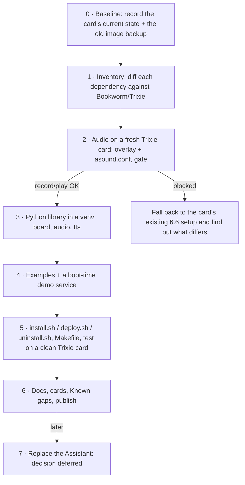

# Plan: AIY Voice Kit v1 on a current Raspberry Pi OS (Trixie)

Written 2026-10-21. Modelled on `../vision-kit` (same phases, layout, Makefile menu, cards and docs conventions).

## Goal

Run the [Google AIY Voice Kit v1](https://aiyprojects.withgoogle.com/voice-v1/) (Raspberry Pi 3 B + **Voice HAT**: I2S mics
and amplifier, arcade button with LED on the button connector) on Raspberry Pi OS Lite **Trixie** (kernel 6.18), with the AIY
Python library, its examples and a one-command `deploy.sh`, as `vision-kit` does.

## What we already know (checked 2026-10-21)

The card at `pi@192.168.68.74` (hostname `lemic`; was `192.168.0.104`):

| | |
|---|---|
| Board | Raspberry Pi 3 Model B Rev 1.2, HAT EEPROM: "Google AIY audioHAT Board v1" |
| OS | Raspberry Pi OS **Bookworm 64-bit**, kernel `6.6.51+rpt-rpi-v8`, Python 3.11.2 |
| Audio | `dtoverlay=googlevoicehat-soundcard` (+ `i2s-mmap`): card 0 `sndrpigooglevoi`, playback and capture both work |
| Running | `wyoming-satellite.service` (a Home Assistant voice satellite, port 10700), which **holds the mic** |
| Old setup | `~/hepp/` and `~/hepp.tgz` (49 MB): a backup of the original 2017 AIY image: `boot/`, `etc/`, `AIY-voice-kit-python` at `c9e8471` (2017-09-11), `assistant-sdk-python` |

What this means for the port, compared with vision-kit:

- **No kernel driver work.** The Voice HAT drivers (`snd-soc-googlevoicehat-codec`, `snd-soc-rpi-simple-soundcard`) and the overlay are
  in the Raspberry Pi kernel tree, and they already work on 6.6. No DKMS, no firmware, no `fetch-binaries.sh`. (The out-of-tree
  `drivers/sound/` in `aiyprojects-raspbian` is for the **v2 Voice Bonnet**, rt5645, and doesn't apply.)
- **The codec has no mixer controls** (`amixer scontrols` is empty), so volume and mic gain come from ALSA plugins. The old image's
  `/etc/asound.conf` (saved in `hepp/etc/`) did this: `softvol` named `Master` over `dmix` for playback, and a `route` with ×30 gain over
  `dsnoop` for capture.
- **The cloud side is the hard part.** The Google Assistant SDK/library examples can't work anymore. Per your answer, that's
  deferred: port hardware and audio first, and list the Assistant demos as a Known gap.
- `wyoming-satellite` is in use. Nothing in this plan stops or removes it without asking; tests that need the mic stop it and start it again
  (the same pattern as the vision-kit Joy Detector).

## Which Python library to port

There are two upstream generations:
1. `AIY-voice-kit-python` (2017, on the card in `hepp/`): `aiy.voicehat`, `aiy.audio`, `aiy._drivers`. Voice-HAT-only, Assistant-centred.
2. `aiyprojects-raspbian` (2018–2021, already vendored in `../vision-kit/docs/aiyprojects-raspbian/`): `aiy.board`
   (button on GPIO 23, LED on GPIO 25 for the Voice HAT), `aiy.voice.audio` (arecord/aplay), `aiy.voice.tts` (pico2wave), `aiy.cloudspeech`.

**Recommendation: port (2), starting from vision-kit's already ported `port/python/`.** It supports the Voice HAT, it's the library
Google kept up to date, and vision-kit has already fixed most of what breaks (venv/PEP 668, protobuf, the gpiochip base of 512). Keep (1) only as a
reference for the baseline.

## Phases

### 0 · Baseline (read-only on the card)
- Save to `vendor/baseline/`: `aplay -l`/`arecord -l`, `config.txt`, the module list, the kernel boot log, the HAT EEPROM fields, and the wyoming unit.
- Copy `~/hepp.tgz` to `vendor/` (gitignored) and pull out the old `asound.conf`, systemd units, `AIY-voice-kit-shell.sh` and the 2017 Python
  library as reference. **Read its contents before using anything from it** (it may hold credentials from the Assistant setup: never commit those).
- Measure once, with wyoming stopped for a minute and started again: a 5 s `arecord` at 16 kHz (peak/RMS level, so later tests have a number
  to compare against), and an `aplay` of a test tone.

### 1 · Inventory → `port/DEPENDENCIES.md`
Mark each item as checked (H/C/?) like vision-kit. Expected items:
- Overlay `googlevoicehat-soundcard` on 6.12 and 6.18 (confirm it's still in `overlays/` on both).
- 32-bit vs 64-bit. The Pi 3 runs both; the card is 64-bit. **Proposed: support both, test 64-bit first** (vision-kit was 32-bit only because of the Pi Zero).
  The Voice HAT also fits a Pi Zero W / Pi 4, so leave that open but untested.
- `RPi.GPIO` in `aiy.board`: works on a Pi 3 under Bookworm, but use the gpiozero/lgpio path vision-kit adopted.
- `pico2wave` (`libttspico-utils`): Debian non-free. Check that it's available for arm64/armhf on Bookworm and Trixie; fallbacks are `espeak-ng` and Piper.
- `google-cloud-speech` (cloudspeech demo): still exists, but needs a GCP service account. Optional extra, not installed by default.
- Assistant SDK / `google-assistant-library`: dead. Document it, don't port it.
- PipeWire is **not** on Lite. Confirm that plain ALSA + `asound.conf` is enough, and that `dmix`/`dsnoop` let wyoming and AIY share the card.

### 2 · Audio on a fresh card (go/no-go)
On a **second SD card** (keep `lemic`'s card as it is), flash Raspberry Pi OS Lite 64-bit **Trixie** and add `dtoverlay=googlevoicehat-soundcard` +
`/etc/asound.conf`. Gate: `arecord` + `aplay` work, the levels match the baseline, `Master` changes the volume. Also check the known
Voice HAT issues: the click/pop when the amp turns on, and whether `i2s-mmap` is still needed.

### 3 · Python library
- `port/python/`: start from vision-kit's ported tree. Drop the vision-only parts (`aiy.vision`, the camera shim) or keep the tree shared;
  decide in phase 1. Venv at `/opt/aiy/venv`, the same as vision-kit.
- Make `aiy.board.Button`/`Led` work for the Voice HAT (GPIO 23/25), plus `aiy.voice.audio` (Recorder, play_wav) and `aiy.voice.tts.say`.
- `port/tests/hardware_check.py`: LED blink, button (interactive or skippable), record → play loopback, TTS.

### 4 · Examples + demo service
- Run `examples/voice/voice_recorder.py`, `button_led.py` and the `tts` examples. Patch them only where needed (`port/python.patch`).
- A small boot-time demo that needs no cloud (press button → record → play it back, LED shows the state), as an optional service like the Joy Detector,
  **disabled by default** while wyoming owns the card.

### 5 · Install and test on a clean card
- `port/install.sh` (overlay line, asound.conf, apt packages, venv, udev/groups, optional service), `deploy.sh pi@host`, `uninstall.sh`.
  No DKMS or kernel hold.
- Root `Makefile` with the numbered menu (from the `makefile-actions` skill, with `"$(MAKE)"` quoted): `deploy`, `reboot`, `status`, `test_hw`,
  `test_audio`, `test_tts`, `uninstall`, `check_docs`. `HOST ?= pi@192.168.68.74` for `lemic` (the fresh card gets its own host).
- Reflash the Trixie card and check that `deploy.sh` alone sets it up and every test passes. Then 32-bit Trixie, if wanted.

### 6 · Docs and publishing
- `README.md` (status, install, a "Why it isn't just apt upgrade" table), `port/README.md` (SD card prep, install, Known gaps),
  `CLAUDE.md` plus `cards/`, the same structure as vision-kit. Snapshot only the voice parts of the upstream docs into `docs/`, under their licenses.
- Licensing as vision-kit: `port/python/` is Apache-2.0, and there are no GPL drivers here.
- New GitHub repo (e.g. `epatel/aiy-voice-kit`): only when you say so.

### 7 · Later: what replaces the Assistant (deferred)
Options for when you decide: the Claude API (button → STT → Claude → TTS), fully local (Vosk/whisper.cpp + Piper), or keep the card as a Wyoming
satellite and expose the button/LED to Home Assistant. The last one fits what `lemic` already does.

## Decisions (2026-10-21)
1. `lemic`'s current card is the baseline only (phase 0). The fresh install goes on a **second SD card**.
2. AIY and wyoming sharing the card: **undecided**. Wyoming opens `plughw` directly, so sharing would mean pointing it at a dsnoop/dmix `default`. Revisit in phase 5.
3. The `aiy` Python tree is **this repo's own copy** (seeded from vision-kit's `port/python/`), not shared.
4. **Trixie only; Bookworm skipped.** Trixie's kernel (6.18.50 in `archive.raspberrypi.com` on 2026-10-21) has the same Voice HAT driver and overlay,
   and `python3-rpi-lgpio`/`python3-lgpio`/`python3-gpiozero` and `libttspico-utils` are all there for arm64 and armhf. Bookworm will probably work
   (`lemic` runs the same audio stack on 6.6) but isn't a tested target.

## Progress
- **Phase 0 done (2026-10-21).** See `vendor/baseline/SUMMARY.md`. The current Bookworm card's Voice HAT audio works on 6.6 with the stock overlay.
  The raw mic level is about −63 dBFS RMS in a quiet room with no gain (hence the old ×30 boost). No credentials are in the 2017 backup.
- **Phase 1 done (2026-10-21).** See `port/DEPENDENCIES.md`. No blockers: the driver and overlay are unchanged in 6.12/6.18 and built in every Pi defconfig.
  Drop `i2s-mmap` (the overlay is gone). The HAT EEPROM's DT is rejected, so the overlay line must stay explicit. Small Python fixes: tts quoting and run dir.
  cloudspeech needs the 2.x API (optional). The Assistant modules aren't ported.
- **Phase 2 gate passed (2026-10-21)** on `pi@voice-kit.local` (Trixie 64-bit, 6.18.50): overlay + `port/alsa/asound.conf` give working record/play,
  dmix/dsnoop sharing and `Master` volume, with no `i2s-mmap`. Mic gain changed from ×30 to ×4 (from a speech measurement). pico2wave and rpi-lgpio PWM work.
  Open: a normal-voice gain check, the amp pop, and the button press.
- **Phase 3 done (2026-10-21)** (silent tests): own `port/python/` copied from the upstream snapshot (`docs/aiyprojects-raspbian/`, now vendored here).
  Fixes: the arecord 1.2.14 WAV header after SIGTERM (`_fix_wav_sizes`) and the tts quoting/run dir. `port/tests/hardware_check.py` passes.
  Open: `--play`/`--button` with you present, cloudspeech 2.x.
- **Phase 4 done (2026-10-21)** (silent tests): `voice_echo_demo.py` (push-to-talk echo) + `voice_echo_demo.service` (installed disabled). The demo logic passes
  with a simulated button. Open, with you present: the real button, speaker playback, `voice_recorder.py`/`button_led.py`, normal-voice gain.
- **Phase 5 done (2026-10-21).** `port/install.sh`/`deploy.sh`/`uninstall.sh` + the `Makefile` (HOST defaults to `pi@voice-kit.local`).
  On the dev card: install over the hand setup (no changes needed), service enable/keep/disable with quoted `--echo-args`, uninstall (config.txt back to the
  original byte for byte, onboard audio after reboot), fresh install + reboot, then `status`, `test_hw`, `test_echo` all OK. **Freshly flashed Trixie Lite
  64-bit card**: `make deploy` alone (1 min 38 s; apt added `python3-setuptools` + 10 dependencies and pico TTS) → `make reboot` → `status`, `test_hw`,
  `test_echo` all OK. Not done: 32-bit Trixie.
- **Phase 6 (2026-10-21)**: `port/README.md` (SD card prep, install, what gets installed, using it, Known gaps) and `docs/README.md` (index of the snapshot
  for the Voice Kit). README, CLAUDE.md and cards were done earlier. Trimming the snapshot to its voice parts is left to you (the auto-mode check blocks
  deleting under `docs/aiyprojects-raspbian/`). No GitHub repo yet. Found on the way: `Master` is missing on a fresh install, so `make test_play` failed;
  fixed with `aiy-voice-volume.service`, after which `test_play` worked through the speaker. Decision 2 (sharing with wyoming): nothing in the
  install blocks it, since `default` is dmix/dsnoop; wyoming would need `--mic-command 'arecord -D default …'`. Still undecided, not needed for this card.
