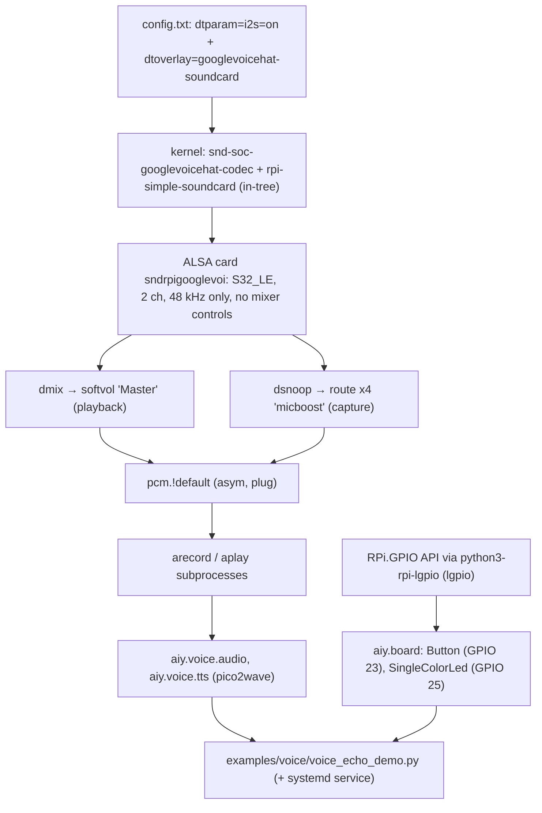

# architecture

How the Voice HAT's hardware, the kernel, ALSA and the `aiy` Python library connect on the Pi, and where each piece lives in the repo and on the card.

## Hardware (Voice HAT on a Pi 3 B)

| Part | Pi side |
|---|---|
| Two MEMS mics (stereo) + mono class-D amp | I2S on GPIO 18–21 |
| Amp enable (SD_MODE) | GPIO 16, driven by the codec driver 5 ms after playback starts (avoids a pop) |
| Arcade button | GPIO 23, active low, pull-up |
| Button LED (single colour) | GPIO 25, software PWM for dimming and patterns |
| HAT EEPROM | identifies "Google AIY audioHAT Board v1"; its embedded device tree is too old and the firmware rejects it |

Those GPIOs must stay free for anything else added to the Pi.

## Stack

There are no out-of-tree drivers, no firmware and no DKMS. The kernel side is entirely Raspberry Pi OS's own; this port only configures it.

## Where things live

| Repo | On the Pi |
|---|---|
| `port/alsa/asound.conf` | `/etc/asound.conf` |
| (config lines, see above) | `/boot/firmware/config.txt` (original saved as `config.txt.orig`) |
| `port/python/` | `/opt/aiy/python`, installed editable into `/opt/aiy/venv` (`--system-site-packages`) |
| `port/systemd/voice_echo_demo.service` | `/etc/systemd/system/voice_echo_demo.service` (`@USER@` → `pi`), disabled |
| `port/tests/` | `~/voice-kit-port/tests/` |

The upstream library is in `docs/aiyprojects-raspbian/` (a read-only snapshot), and `port/python.patch` is the port's diff against it.
`vendor/` (gitignored) holds the phase 0 baseline from the old Bookworm card, its recordings, and a backup of Google's 2017 image.
