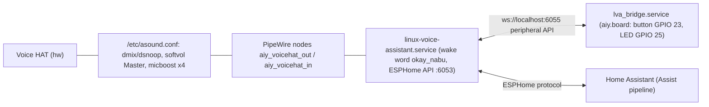

# ha-satellite

The kit as a Home Assistant voice satellite (`install.sh --ha-satellite`): Linux Voice Assistant (LVA) on PipeWire over our ALSA devices, plus
`lva_bridge.py` for the button and LED. Home Assistant (HA) does speech-to-text, intents or an LLM, and TTS.

## Stack on the Pi

- **PipeWire never opens the HAT directly.** `wireplumber-51-aiy-voicehat.conf` disables the auto-created card (`alsa_card.platform-soc_sound`, and HDMI).
  `pipewire-51-aiy-voicehat.conf` adds a sink over `plug:softvol` and a source over `plug:micboost` (S32LE, 48 kHz, 2 ch). That's what keeps `Master`
  and the ×4 gain working, and lets `arecord -D default` / `aiy.voice.audio` record while LVA listens (checked). Opened directly, PipeWire would play at full
  volume and lock out ALSA programs. `pipewire-alsa` isn't installed, so ALSA `default` stays ours.
- The LVA service uses the node **descriptions** as device names (`"Voice HAT mics (x4 gain)"`, `pulse/aiy_voicehat_out`); keep them in sync.
- PipeWire runs in the user's session: install enables **linger** and starts `user@UID`. The LVA unit is a system service with `User=`,
  `XDG_RUNTIME_DIR`/`PULSE_SERVER` pointing at `/run/user/UID`, and an `ExecStartPre` that waits for `pactl info`.
- LVA is cloned to `/opt/aiy/linux-voice-assistant` (owned by the user), pinned by `LVA_COMMIT` in install.sh. Its `script/setup` builds `.venv` from
  **PyPI** (an exception to the apt-only rule: third-party app, own venv) and runs only when the commit changes or the venv is missing. Preferences
  (wake words, LVA volume, mic gain) are in `preferences.json` there.
- `wyoming-satellite` (what the old `lemic` card runs) was archived in January 2026; LVA is its successor.

## Bridge (port/python/src/examples/voice/lva_bridge.py)

LED: wake word / listening ON, thinking BLINK, speaking PULSE_QUICK, idle OFF, muted BEACON_DARK, no LVA or HA connection BLINK_3, timer BLINK.
Button: short press → `start_listening`, or `stop_pipeline` while busy, or `stop_timer_ringing`; held ≥ 2 s → `mute_mic`; any press while muted → `unmute_mic` (LVA ignores `start_listening` while muted, which felt like a dead button in the first hand test).
`websockets` (apt `python3-websockets` 15, `connect()` as an async iterator reconnects by itself). Button callbacks come from aiy.board's thread and go to
the asyncio loop with `call_soon_threadsafe`. Test: `make test_bridge` (fake LVA server on port 16055, fake board; silent).

The bridge and the echo demo both hold the button and LED: install.sh refuses to enable both, and the Makefile test targets stop either while testing.

## Home Assistant side (not installed by this repo)

HA finds the satellite as an ESPHome device (port 6053). It needs an Assist pipeline with speech-to-text and TTS. The tested setup (2026-10-21, HA 2026.5.4
in Docker on a Pi 5 with a 32-bit userland): `rhasspy/wyoming-whisper` (`small-int8`, `--language sv`) and `rhasspy/wyoming-piper` (`sv_SE-nst-medium`) as
containers, added through the Wyoming integration. On a 32-bit Docker those need `--platform linux/arm64 --security-opt seccomp=unconfined` (otherwise
"no matching manifest for linux/arm/v8", then exit 159 = SIGSYS). HA's voice wizard offers no local option for Swedish; build the pipeline by hand.
Measured: "Vad är klockan?" took 5.7 s from end of speech to transcript (Whisper beam size 5); intent and Piper TTS were instant.
