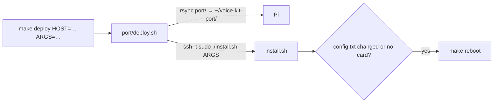

# install-and-deploy

How a Pi gets set up: `port/deploy.sh` (from the Mac), `port/install.sh` (on the Pi), `port/uninstall.sh`, and the root `Makefile` that wraps them.

## Flow

`deploy.sh` quotes the options with `printf ' %q'`: macOS's `/bin/bash` is 3.2, which has no `${*@Q}` and treats an empty `"$@"` as unbound under `set -u`.
It needs SSH key login and passwordless sudo.

## What install.sh touches (it is safe to re-run)

| What | How | Undone by uninstall.sh |
|---|---|---|
| apt | `alsa-utils python3-venv python3-setuptools python3-gpiozero python3-lgpio python3-rpi-lgpio`; `libttspico-utils` separately, a warning if non-free is off | no (packages stay) |
| groups | user added to `audio`, `gpio` | no |
| `config.txt` | `dtparam=audio=on` → `#dtparam=audio=on  # aiy-voice-kit: …`; a `# >>> aiy-voice-kit` … `# <<<` block with `dtparam=i2s=on` + `dtoverlay=googlevoicehat-soundcard`. Skipped if the overlay line exists already (hand setups). Backup `config.txt.orig-aiy` | block, hand-setup overlay/i2s lines, and the comment-out are reversed; the backup is deleted |
| `/etc/asound.conf` | `port/alsa/asound.conf`. A foreign one is saved as `.orig-aiy`; ours is recognised by its "AIY Voice HAT" header | restored or removed |
| `/opt/aiy/python`, `/opt/aiy/venv` | tar copy without `__pycache__`/egg-info, venv with `--system-site-packages`, `pip install --no-index --no-build-isolation -e`, then an import check | removed |
| `voice_echo_demo.service` | `@USER@` and `@ECHO_ARGS@` filled in with sed | disabled and removed |

The firmware rejects the HAT EEPROM's device tree, so the overlay line is required. A reboot is needed after the first install. install.sh says so when it
changed `config.txt` or `sndrpigooglevoi` isn't in `aplay -l`.

## Options

- `--user NAME`: defaults to `$SUDO_USER` or `pi`.
- `--echo-service` / `--no-echo-service`: with neither, a re-run keeps the service's enabled state and its `ExecStart` arguments, and new installs are disabled.
  When enabled with no reboot pending, the service is restarted so new code runs.
- `--echo-args "…"`: passed to `voice_echo_demo.py`, sed-escaped (`\`, `&`, `|`).

## Makefile

Numbered menu from the `makefile-actions` skill (`make` alone). `HOST ?= pi@voice-kit.local`, `ARGS`, `VOLUME ?= 20%`, `TEXT`. The test targets use `ON_PI`:
it stops `voice_echo_demo` only if it's active and starts it again afterwards, keeping the test's exit code. After adding a target, run `make update_phony`.

## Tested (2026-10-21, dev card)

Install over the hand setup changed nothing. Uninstall left `config.txt` identical to the pre-AIY original, and the onboard audio came back after a reboot.
A fresh install followed by a reboot passed `status`, `test_hw` and `test_echo`. On a freshly flashed Trixie Lite 64-bit card, `make deploy` + `make reboot`
alone (1 min 38 s for the install; apt adds only `python3-setuptools` with its dependencies and pico TTS) passed the same tests. 32-bit isn't tested.
